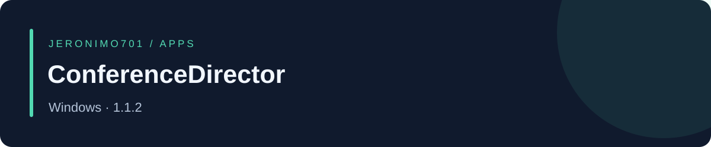
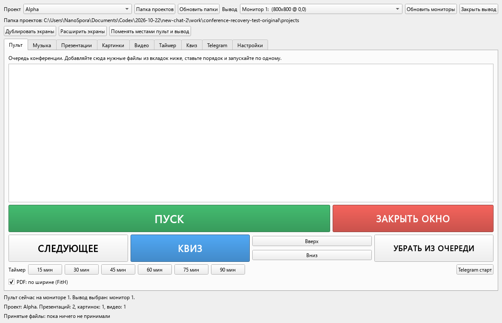

# ConferenceDirector

Пульт конференции: очередь выступлений, презентации, музыка, видео и таймер на одном экране.

**[Скачать 1.1.2](https://github.com/jeronimo701/ConferenceDirector/releases/download/v1.1.2/ConferenceDirectorSetup-1.1.2-clean.exe) · [Описание релиза](https://github.com/jeronimo701/ConferenceDirector/releases/tag/v1.1.2) · [Все выпуски](https://github.com/jeronimo701/ConferenceDirector/releases)**

| Платформа | Версия | Файл |
| --- | --- | --- |
| Windows | 1.1.2 | `ConferenceDirectorSetup-1.1.2-clean.exe` |

## Возможности

**Очередь мероприятия.** Соберите материалы проекта, задайте порядок и запускайте их из общего пульта.

**Медиа и презентации.** Отдельные вкладки для музыки, презентаций, изображений и видео.

**Экран и таймер.** Выбор монитора вывода, управление окнами и быстрые интервалы таймера.

**Telegram.** Разбор экспортированных JSON и вложений; живое подключение отдельно не проверялось.

## Интерфейс



Интерфейс оригинальной сборки на синтетическом проекте в offscreen-проверке.

## Установка

Скачайте установщик EXE из релиза, запустите его и откройте ConferenceDirector. Выберите папку проектов, добавьте материалы и укажите монитор вывода. Для показа PowerPoint потребуется установленное совместимое ПО.

## Статус выпуска

Установщик содержит оригинальный EXE от 15 мая 2026 и его runtime без сохранённых пользовательских настроек. Номер 1.1.2 взят из имени авторской папки. Найдены оригинальные исходники: 13 модулей, 217 объектов кода сопоставлены с EXE. Проверены интерфейс, таймер и синтетические проекты; реальные мониторы, PowerPoint и сеть Telegram в публикации не проверялись.

Контрольные суммы и сопроводительные лицензии находятся в файлах релиза.

## Сборка из исходников

```powershell
python -m pip install -r requirements.txt
python conference_director.py
```

Python 3.13 и PySide6. Рецепт сборки: `build.ps1`, зависимости: `requirements-build.txt`. Подробности происхождения исходников и проверок — [recovery](recovery/).

## Лицензия

Собственный код распространяется на условиях [Jeronimo701 Personal Use 1.0](LICENSE.txt). Публичный доступ к репозиторию не отменяет условий использования. Область действия: [LICENSE-SCOPE.md](LICENSE-SCOPE.md). Условия сторонних компонентов: [THIRD-PARTY.md](THIRD-PARTY.md).
